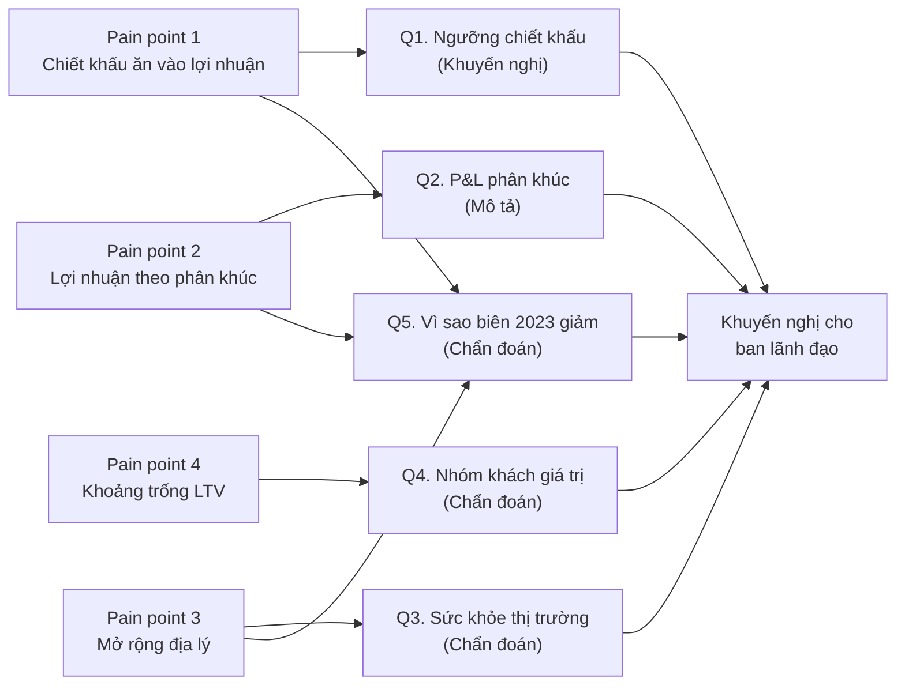

# CHƯƠNG 1. GIỚI THIỆU

## 1.1. Bối cảnh doanh nghiệp

Xóm E-Com là sàn thương mại điện tử B2C đa khu vực, không có cửa hàng vật lý. Toàn bộ giao dịch diễn ra qua web và ứng dụng di động, hàng được giao trực tiếp đến khách thông qua các đối tác logistics. Theo mô tả của nhà cung cấp dữ liệu, doanh nghiệp có doanh thu khoảng 2,3 triệu USD mỗi năm và biên lợi nhuận gộp khoảng 20%, thấp hơn bán lẻ truyền thống vì chi phí logistics và chính sách chiết khấu mạnh. Dữ liệu thực tế (Chương 2) cho thấy sàn kinh doanh năm ngành hàng mỹ phẩm và chăm sóc cá nhân, phục vụ ba phân khúc khách hàng (Consumer, Corporate, Self-Employed) tại 164 quốc gia thuộc năm thị trường.

Trong thương mại điện tử, doanh thu dễ tăng nhờ quảng cáo và giảm giá, nhưng lợi nhuận lại phụ thuộc vào cơ cấu chiết khấu, phân khúc, thị trường và hành vi quay lại của khách. Nếu chỉ theo dõi doanh thu trên các file rời rạc, nhà quản lý có thể đưa ra quyết định mở rộng hoặc khuyến mãi làm giảm lợi nhuận mà không nhận ra. Vì vậy Xóm E-Com cần một kho dữ liệu tích hợp, có quy tắc chất lượng rõ ràng và có định nghĩa chỉ số thống nhất, để đo lường lợi nhuận đa chiều thay vì chỉ xem doanh thu.

## 1.2. Bốn vấn đề cần giải quyết

Ban lãnh đạo Xóm E-Com (Head of Growth, Head of Finance, CMO, Head of Merchandising) nêu bốn vấn đề kinh doanh (pain point) chưa ai đo lường được:

1. **Chiết khấu ăn vào lợi nhuận (discount cannibalization).** Marketing chạy giảm giá sâu để kéo sản lượng nhưng không đo tác động lên lợi nhuận; có những đơn giảm đến 80% và bị lỗ.
2. **Lợi nhuận theo phân khúc.** Ban lãnh đạo cho rằng Corporate là "cash cow", nhưng CFO chưa từng lập P&L theo phân khúc.
3. **Mở rộng địa lý.** Doanh nghiệp cần biết thị trường nào đang tăng trưởng lành mạnh, thị trường nào đã bão hòa hoặc tăng trưởng nhờ giảm giá.
4. **Khoảng trống giá trị vòng đời khách hàng (LTV).** Phần lớn khách mua một lần rồi không quay lại.

::table B1.1 | Bốn pain point của Xóm E-Com và dữ liệu tương ứng | Nhóm thực hiện, tổng hợp từ bối cảnh doanh nghiệp
| Pain point | Bảng và cột dữ liệu liên quan | Câu hỏi |
|---|---|---|
| 1. Chiết khấu ăn vào lợi nhuận | ecom_sales (discount, sales, profit), product (category) | Q1, Q5 |
| 2. Lợi nhuận theo phân khúc | ecom_sales (segment, sales, profit), customer | Q2, Q5 |
| 3. Mở rộng địa lý | ecom_sales (order_date), region (country, market) | Q3, Q5 |
| 4. Khoảng trống LTV | ecom_sales (customer_id, order_id, order_date), customer | Q4 |

{H1.1} tóm tắt quan hệ giữa bốn pain point và năm câu hỏi nghiên cứu. Riêng Q5 cắt ngang ba pain point đầu, vì biên lợi nhuận năm 2023 giảm có thể do chiết khấu, do cơ cấu phân khúc hoặc do thị trường.

::mermaid H1.1 H1_1_bai_toan_kinh_doanh | Sơ đồ bài toán kinh doanh: bốn pain point dẫn tới năm câu hỏi nghiên cứu

## 1.3. Câu hỏi nghiên cứu

Năm câu hỏi được chia theo ba tầng phân tích: mô tả (điều gì đang xảy ra), chẩn đoán (vì sao) và khuyến nghị (nên làm gì).

::table B1.2 | Câu hỏi nghiên cứu Q1 đến Q5 theo ba tầng phân tích | Nhóm thực hiện
| Mã | Câu hỏi | Tầng | Pain point |
|---|---|---|---|
| Q1 | Mức chiết khấu nào khiến giao dịch bắt đầu lỗ, và nếu giới hạn mức giảm giá thì lợi nhuận thay đổi ra sao? | Khuyến nghị | 1 |
| Q2 | P&L theo phân khúc: Corporate có thật sự hiệu quả nhất khi xét cả biên lợi nhuận? | Mô tả | 2 |
| Q3 | Thị trường nào tăng trưởng lành mạnh, thị trường nào bão hòa hoặc tăng nhờ giảm giá? | Chẩn đoán | 3 |
| Q4 | Nhóm khách nào có LTV cao, và vì sao đa số khách chỉ mua một lần? | Chẩn đoán | 4 |
| Q5 | Vì sao biên lợi nhuận 2023 giảm ở mọi thị trường, ngay cả ở dòng không giảm giá? | Chẩn đoán | 1, 2, 3 |

## 1.4. Mục tiêu

**Mục tiêu nghiệp vụ:** lập P&L theo phân khúc, xác định ngưỡng chiết khấu hiệu quả, đánh giá sức khỏe từng thị trường, phân nhóm khách hàng để có chính sách giữ chân, và chẩn đoán nguyên nhân giảm biên năm 2023.

**Mục tiêu kỹ thuật:** xây kho dữ liệu Medallion trên DuckDB; kiểm thử chất lượng bằng dbt; mô hình hóa Gold theo Kimball; xây dựng metric catalog và data mart; huấn luyện mô hình học máy bằng Python trên dữ liệu Gold và ghi kết quả về kho; xuất dữ liệu cho dashboard Power BI; bảo đảm toàn bộ hệ thống tái lập được.

::table B1.3 | Mục tiêu nghiệp vụ, mục tiêu kỹ thuật và tiêu chí hoàn thành | Nhóm thực hiện
| Mục tiêu | Tiêu chí hoàn thành | Nơi chứng minh |
|---|---|---|
| Kho dữ liệu Medallion trên DuckDB | Có đủ 3 tầng bronze, silver, gold trong một file .duckdb | Mục 3.3–3.5, 4.1 |
| Chất lượng dữ liệu | 100% bài kiểm thử dbt đạt; số dòng và tổng tiền khớp giữa các tầng | Mục 4.2, 4.3 |
| Mô hình hóa Kimball | Có grain, fact, dimension, surrogate key, thành viên Unknown | Mục 3.5 |
| KPI và data mart | 9 KPI định nghĩa một lần; 5 data mart phục vụ Q1–Q5 | Mục 3.6, 3.7 |
| Khai phá dữ liệu và học máy trên kho | Đủ phân lớp, phân cụm, luật kết hợp (CLO5) cùng hồi quy và chuỗi thời gian; đánh giá theo thời gian; kết quả ghi vào schema ml | Mục 3.10, 4.4, 4.5 |
| Trả lời Q1–Q5 | Mỗi câu có số liệu bằng chứng và khuyến nghị | Mục 4.4, 4.7 |
| Dashboard | Đặc tả 4 trang Power BI đọc CSV xuất từ data mart | Mục 4.6, Phụ lục C |
| Tái lập | Một lệnh chạy lại toàn bộ pipeline | Phụ lục A |

## 1.5. Phạm vi và giới hạn

Đề tài sử dụng bốn bảng CSV giai đoạn 01/2020 đến 12/2023. Dữ liệu tĩnh và được nạp theo lô (batch). Dữ liệu không có cột chi phí, nên chi phí ngầm được tính bằng `sales - profit`. Đề tài không triển khai nạp gia tăng, CDC, hỏi đáp dữ liệu bằng AI (Generative BI), knowledge graph hay blockchain; các nội dung này được đưa vào hướng phát triển ở Chương 5.

## 1.6. Ý nghĩa và lợi ích của đề tài

Về thực tiễn, kho dữ liệu cho ban lãnh đạo một "nguồn sự thật duy nhất": mọi báo cáo dùng cùng định nghĩa doanh thu, lợi nhuận, biên và cùng quy tắc làm sạch, nên con số giữa bộ phận Tài chính và Marketing không còn lệch nhau. Các phân tích chiết khấu, phân khúc, thị trường và khách hàng chuyển trực tiếp thành khuyến nghị có ước lượng tác động bằng tiền.

Về học thuật, đề tài áp dụng đầy đủ các kỹ thuật của học phần: kiến trúc kho dữ liệu nhiều tầng, quy trình ELT, mô hình hóa đa chiều theo Kimball (degenerate dimension, junk dimension, periodic snapshot fact), quản lý chất lượng dữ liệu theo bốn chiều, metric catalog, data lineage, che dữ liệu cá nhân, khai phá dữ liệu và học máy trên kho dữ liệu. Ba nhóm thuật toán khai phá cốt lõi mà chuẩn đầu ra CLO5 của học phần nêu tên (phân lớp, phân cụm, luật kết hợp) đều được áp dụng vào một câu hỏi kinh doanh cụ thể, bên cạnh hồi quy, chuỗi thời gian, phát hiện bất thường và giám sát model drift.

## 1.7. Tham khảo dự án mã nguồn mở

Nhóm tham khảo dự án mã nguồn mở `a-simple-t2s-flow` của cộng đồng Xóm Data. Dự án này dựng pipeline SQL Server → dlt → DuckDB → dbt (Bronze, Silver, Gold) trên cùng bộ dữ liệu Xóm E-Com. Nhóm kế thừa mẫu cấu hình dbt-duckdb, macro chia an toàn `safe_divide`, ý tưởng phân tích giỏ hàng bằng self-join và cấu trúc script điều phối. Bên cạnh đó, nhóm sửa các điểm chưa phù hợp với yêu cầu học phần:

- tầng Silver của dự án làm mất khóa dòng `row_id`;
- RFM và churn tính theo `current_date`, nên kết quả không tái lập được;
- tầng Gold chỉ là các bảng tổng hợp rời, chưa theo star schema;
- kiểm thử còn mỏng, và mô tả phân khúc, ngành hàng chưa khớp dữ liệu thật.
