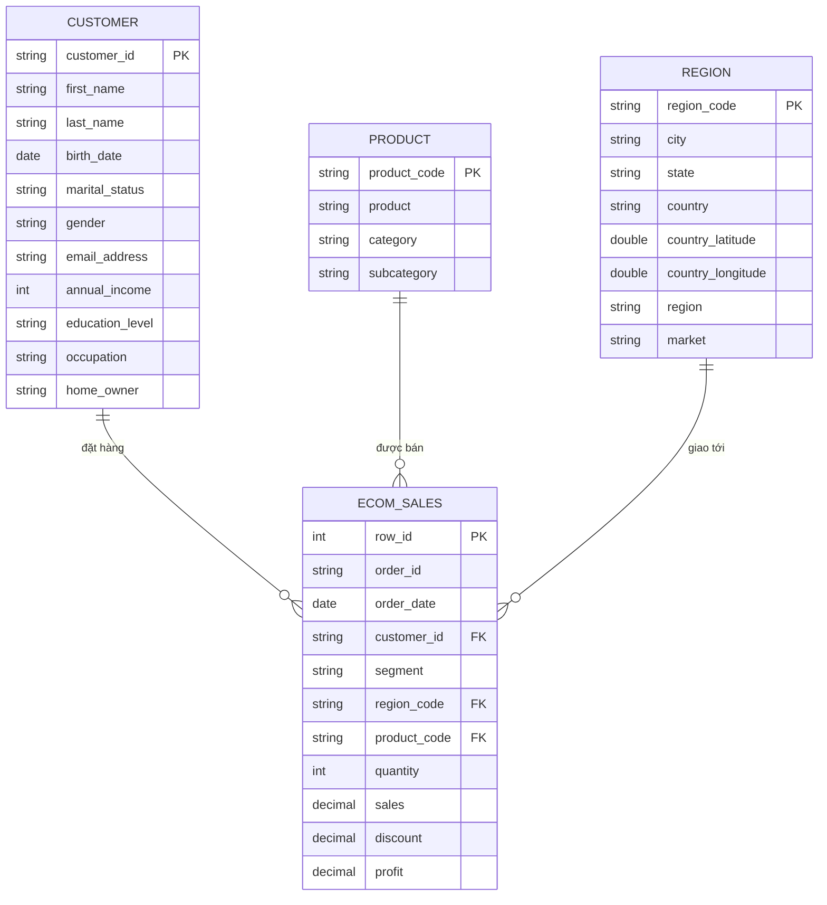

# CHƯƠNG 2. MÔ TẢ VÀ PHÂN TÍCH TỔNG QUAN DỮ LIỆU

Bộ dữ liệu gồm bốn bảng theo dạng hình sao, với 51.290 dòng giao dịch, và có chất lượng tốt: không trùng khóa, không thiếu giá trị ở cột giao dịch. Ngoại lệ chỉ gồm 124 khách thiếu giới tính và 3 dòng giao dịch mang mã sản phẩm hoặc khu vực không có trong danh mục. Mọi số liệu trong chương được tính lại bằng SQL trên kho DuckDB sau khi xây dựng; các con số khảo sát ban đầu trong đề cương đã được xác nhận hoặc hiệu chỉnh.

## 2.1. Nguồn gốc và quy mô dữ liệu

Dữ liệu do Xóm E-Com cung cấp qua nền tảng Xóm Dataset (schema `e_commerce`) dưới dạng bốn file CSV, nạp một lần (dữ liệu tĩnh). Thời gian giao dịch trải từ 01/01/2020 đến 31/12/2023.

::table B2.1 | Quy mô bốn bảng dữ liệu nguồn | Nhóm thực hiện, đếm trên tầng Bronze của DuckDB
| Bảng | Số dòng | Số cột | Khóa chính | Nội dung |
|---|---|---|---|---|
| ecom_sales | 51.290 | 11 | row_id | Giao dịch: ngày, khách, phân khúc, khu vực, sản phẩm, số lượng, doanh thu, chiết khấu, lợi nhuận |
| customer | 17.415 | 11 | customer_id | Họ tên, ngày sinh, giới tính, hôn nhân, thu nhập, học vấn, nghề nghiệp, sở hữu nhà, email |
| product | 28.356 | 4 | product_code | Tên sản phẩm, ngành hàng (category), nhóm hàng (subcategory) |
| region | 3.828 | 8 | region_code | Thành phố, bang, quốc gia, tọa độ quốc gia, vùng (region), thị trường (market) |

Bảng giao dịch chứa 25.728 đơn hàng (order_id phân biệt) của 17.415 khách, tức bình quân 1,99 dòng mỗi đơn và 1,48 đơn mỗi khách. Toàn kỳ có 6.517.674 USD doanh thu và 1.065.413,58 USD lợi nhuận, biên lợi nhuận 16,3%.

## 2.2. Từ điển dữ liệu

::table B2.3 | Từ điển dữ liệu bốn bảng nguồn và ghi chú xử lý | Nhóm thực hiện
| Bảng.cột | Kiểu (sau Silver) | Ý nghĩa | Ví dụ | Ghi chú xử lý |
|---|---|---|---|---|
| ecom_sales.row_id | INTEGER | Khóa dòng giao dịch | 1 | Grain của fact_sales |
| ecom_sales.order_id | VARCHAR | Mã đơn hàng, một đơn nhiều dòng | MX-2015-SC2057582-42279 | Degenerate dimension; năm trong mã lệch 8 năm so với order_date |
| ecom_sales.order_date | DATE | Ngày đặt hàng | 2023-10-02 | Trục thời gian duy nhất |
| ecom_sales.customer_id | VARCHAR | Mã khách | SC-2057582 | Khóa ngoại tới customer |
| ecom_sales.segment | VARCHAR | Phân khúc | Consumer | Consumer, Corporate, Self-Employed |
| ecom_sales.region_code | VARCHAR | Mã khu vực | R2140 | 2 dòng không khớp, gắn cờ |
| ecom_sales.product_code | VARCHAR | Mã sản phẩm | P000409 | 2 dòng không khớp, gắn cờ |
| ecom_sales.quantity | INTEGER | Số lượng | 3 | 1 đến 20 |
| ecom_sales.sales | DECIMAL(12,2) | Doanh thu dòng (USD) | 48,00 | 2 đến 3.940 USD |
| ecom_sales.discount | DECIMAL(5,2) | Tỷ lệ chiết khấu | 0,00 | 0 đến 0,85 |
| ecom_sales.profit | DECIMAL(12,2) | Lợi nhuận dòng (USD) | 19,20 | Có thể âm, giữ nguyên |
| customer.first_name, last_name | VARCHAR | Họ tên | Bryant Vazquez | Dữ liệu cá nhân, không đưa lên Gold |
| customer.birth_date | DATE | Ngày sinh | 1980-01-21 | Đổi thành tuổi và nhóm tuổi tại 31/12/2023 |
| customer.gender | VARCHAR | Giới tính M/F | M | 124 NULL, gán Unknown |
| customer.marital_status | VARCHAR | Hôn nhân M/S | M | Đổi thành Married/Single |
| customer.email_address | VARCHAR | Email | (ẩn) | Băm md5 ở Gold |
| customer.annual_income | INTEGER | Thu nhập năm (USD) | 20.000 | 10.000 đến 170.000; nhóm thu nhập |
| customer.education_level | VARCHAR | Học vấn | Bachelors | 5 giá trị |
| customer.occupation | VARCHAR | Nghề nghiệp | Clerical | 5 giá trị |
| customer.home_owner | BOOLEAN | Sở hữu nhà Y/N | Y | Đổi sang true/false |
| product.product | VARCHAR | Tên sản phẩm | Soap & Glory Endless Glove... | |
| product.category | VARCHAR | Ngành hàng | Body care | 5 ngành |
| product.subcategory | VARCHAR | Nhóm hàng | bath oils, bubbles and soaks | Chuẩn hóa chữ thường |
| region.city, state, country | VARCHAR | Địa danh | Jalalabad, Nangarhar, Afghanistan | 164 quốc gia |
| region.country_latitude, longitude | DOUBLE | Tọa độ quốc gia | 33,94; 67,71 | Dùng cho bản đồ |
| region.region | VARCHAR | Vùng | Southern Asia | Mỹ chia 4 vùng, Sudan 2 vùng |
| region.market | VARCHAR | Thị trường | Asia Pacific | 5 thị trường; thêm market_group |

## 2.3. Đối chiếu mô tả của nhà cung cấp với dữ liệu thực tế

Một số thông tin trong mô tả gốc của nhà cung cấp khác với dữ liệu CSV. Báo cáo dùng số liệu thực tế và ghi nhận các khác biệt trong {B2.2}.

::table B2.2 | Đối chiếu mô tả của nhà cung cấp với dữ liệu thực tế | Nhóm thực hiện, truy vấn trên kho DuckDB
| Hạng mục | Mô tả nhà cung cấp | Dữ liệu thực tế |
|---|---|---|
| Doanh thu | ~2,3 triệu USD mỗi năm | 1,15 / 1,41 / 1,77 / 2,19 triệu USD (2020–2023); chỉ khớp với năm 2023 |
| Quốc gia | Hơn 140 | 164 |
| Ngành hàng | Office Supplies, Furniture, Technology | Body care, Home and Accessories, Hair care, Make up, Face care |
| SKU | ~1.900 | 28.356 trong danh mục, 3.576 có phát sinh bán |
| Thị trường | US, EMEA, APAC, LATAM | USCA, Europe, Africa, Asia Pacific, LATAM (EMEA = Europe + Africa) |
| Phân khúc | Consumer, Corporate, Home Office | Consumer, Corporate, Self-Employed |
| Tỷ trọng theo số lượng bán | 60% / 25% / 15% | 33,2% / 58,4% / 8,4% (Consumer / Corporate / Self-Employed); theo số dòng: 51,7% / 30,1% / 18,2% |
| Biên lợi nhuận gộp | ~20% | 16,3% toàn kỳ; khoảng 18% năm 2020–2022; 12,8% năm 2023 |
| Chiết khấu | 20–80% | 0–85%; 57,5% số dòng không giảm giá |

## 2.4. Quan hệ giữa các bảng

`ecom_sales` là bảng trung tâm, nối với `customer` qua `customer_id`, với `product` qua `product_code` và với `region` qua `region_code`. Một đơn hàng có nhiều dòng (trung bình khoảng hai dòng). Mỗi khách thuộc đúng một phân khúc; kiểm tra trên dữ liệu không phát hiện khách nào có hai phân khúc. Sơ đồ quan hệ thực thể của dữ liệu nguồn được trình bày ở {H2.1}.

::mermaid H2.1 H2_1_erd_nguon | Sơ đồ quan hệ thực thể (ERD) của bốn bảng nguồn

## 2.5. Đánh giá chất lượng dữ liệu (data profiling)

Chất lượng dữ liệu được đánh giá theo bốn chiều của học phần: chính xác, đầy đủ, nhất quán và kịp thời, bổ sung thêm chiều duy nhất. Mỗi quy tắc là một câu SQL chạy trên tầng Bronze (script `01_profiling.py`). Kết quả được trình bày ở {B2.4} và {H2.2}.

::csvtable B2.4 | Kết quả profiling chất lượng dữ liệu theo các chiều | Nhóm thực hiện, chạy trên tầng Bronze | B2.4_profiling.csv | Chiều:Chiều:str;Kiểm tra:Kiểm tra:str;Số vi phạm:Số dòng vi phạm:int;Xử lý:Cách xử lý:str

::figure H2.2 H2.2_quality_rules.png | Số dòng vi phạm theo từng quy tắc chất lượng (thang log) | Nhóm thực hiện, script 01_profiling.py

Kết quả cho thấy bộ dữ liệu sạch ở các cột giao dịch. Ba nhóm ngoại lệ cần xử lý có chủ đích:

- **124 khách thiếu giới tính** (0,7% số khách, liên quan 362 dòng giao dịch). Đây là thiếu ngẫu nhiên ở thuộc tính mô tả, không ảnh hưởng đến doanh thu, nên được gán nhãn `Unknown` và giữ bản ghi.
- **Mã không khớp danh mục:** 2 mã sản phẩm (`PPP000010`, `PPP000002`) và 1 mã khu vực (`RRR0001`) xuất hiện ở tổng cộng 3 dòng giao dịch (2 dòng lỗi sản phẩm, 2 dòng lỗi khu vực, trong đó 1 dòng lỗi cả hai). Các mã này có dạng tiền tố bị lặp, nhiều khả năng do lỗi nhập liệu. Chúng được giữ nguyên, gắn cờ `is_valid_product` và `is_valid_region`, và trỏ tới thành viên Unknown (-1) ở Gold, để không làm mất 506 USD doanh thu của 3 dòng này.
- **11.041 dòng lợi nhuận âm** (21,5%). Đây là giao dịch lỗ thật, gắn với chiết khấu sâu (Chương 4), và chính là đối tượng phân tích của Q1, nên được giữ nguyên.

Ngoài ra, năm trong `order_id` luôn nhỏ hơn năm của `order_date` đúng 8 năm ở cả 51.290 dòng. Đây là độ lệch có hệ thống của dữ liệu mô phỏng, nên `order_date` được chọn làm trục thời gian duy nhất. Có 11 `order_id` gắn với nhiều ngày hoặc nhiều khách; số lượng này rất nhỏ (0,04% số đơn) nên được ghi nhận là hạn chế khi đếm đơn. Không phát hiện khách trùng theo email hoặc theo cặp họ tên và ngày sinh.

## 2.6. Khám phá dữ liệu (EDA)

### 2.6.1. Phân phối lợi nhuận và chiết khấu

Lợi nhuận mỗi dòng lệch phải với đuôi âm dài: phần lớn dòng có lợi nhuận dương nhỏ, nhưng 21,5% số dòng bị lỗ ({H2.3}). Chiết khấu có phân phối không liên tục: 57,5% số dòng không giảm giá, phần còn lại phân bố trên 22 mức rời rạc từ 7% đến 85%, tập trung ở các mức 10%, 20%, 40%, 50%, 60% và 70% (sáu mức này chiếm 82% số dòng có giảm giá).

::figure H2.3 H2.3_profit_discount_hist.png | Phân phối lợi nhuận mỗi dòng giao dịch và phân phối mức chiết khấu

### 2.6.2. Doanh thu, lợi nhuận và biên theo năm

Doanh thu tăng đều 22–26% mỗi năm, từ 1,15 triệu USD (2020) lên 2,19 triệu USD (2023). Biên lợi nhuận ổn định quanh 18% trong ba năm đầu, rồi giảm mạnh còn 12,8% vào năm 2023. Hệ quả là lợi nhuận năm 2023 giảm 12,2% so với năm 2022 dù doanh thu vẫn tăng 23,8% ({H2.4}, {B2.5}). Đây là xuất phát điểm của câu hỏi Q5.

::csvtable B2.5 | KPI chính theo năm (năm 0 là toàn kỳ) | Data mart mart_kpi_overview | B2.5a_kpi_by_year.csv | year:Năm:str;revenue:Doanh thu (USD):usd;profit:Lợi nhuận (USD):usd;profit_margin:Biên:pct1;total_orders:Số đơn:int;avg_order_value:AOV (USD):f1;loss_line_rate:Tỷ lệ dòng lỗ:pct1;repeat_customer_rate:Khách quay lại:pct1

::figure H2.4 H2.4_revenue_profit_margin_by_year.png | Doanh thu, lợi nhuận và biên lợi nhuận theo năm

### 2.6.3. Biên lợi nhuận theo nhóm chiết khấu

Biên lợi nhuận giảm đơn điệu theo mức chiết khấu ({H2.5}, {B2.6}). Dòng không giảm giá có biên 31,3% và không có dòng nào lỗ. Nhóm giảm đến 10% vẫn có biên 20,1%, nhưng từ mức trên 10% đã có khoảng 43% số dòng bị lỗ. Biên chuyển sang âm từ nhóm trên 30% (−15,6%), và mọi dòng giảm trên 50% đều lỗ (biên −32,3%). Đây là biểu đồ quan trọng nhất cho Q1.

::csvtable B2.6 | Doanh thu, lợi nhuận và biên theo nhóm chiết khấu (toàn kỳ) | Data mart mart_discount_analysis | B2.5b_discount_bands.csv | discount_band:Nhóm chiết khấu:str;lines:Số dòng:int;share_lines:Tỷ trọng dòng:pct1;revenue:Doanh thu (USD):usd;profit:Lợi nhuận (USD):usd;margin:Biên:pct1;loss_rate:Tỷ lệ dòng lỗ:pct1

::figure H2.5 H2.5_margin_by_discount_band.png | Biên lợi nhuận theo nhóm chiết khấu

### 2.6.4. Cơ cấu theo ngành hàng, thị trường và phân khúc

{H2.6} so sánh doanh thu và biên theo ba chiều phân tích:

- **Ngành hàng:** Body care chiếm 51,3% doanh thu (biên 16,9%). Home and Accessories có biên thấp nhất (13,8%), Face care có biên cao nhất (18,9%) nhưng chỉ chiếm 5,6% doanh thu.
- **Thị trường:** Asia Pacific có doanh thu cao nhất (1,83 triệu USD) nhưng biên thấp nhất (12,5%); Europe có biên cao nhất (22,3%).
- **Phân khúc:** Corporate chiếm 58,9% doanh thu nhưng có biên thấp nhất (15,8%).

::figure H2.6 H2.6_mix_category_market_segment.png | Doanh thu (cột) và biên lợi nhuận (đường) theo ngành hàng, thị trường và phân khúc

### 2.6.5. Phân bố địa lý

Doanh thu trải trên 164 quốc gia nhưng tập trung cao: riêng Mỹ chiếm 20,4% doanh thu toàn sàn ({H2.7}). Biên lợi nhuận giữa các quốc gia chênh lệch rất lớn. Trung Quốc và Ấn Độ đạt gần 30%, trong khi Indonesia gần như hòa vốn (0,1%), còn Thổ Nhĩ Kỳ (−29,0%) và Nigeria (−37,8%) lỗ nặng dù nằm trong nhóm 15 quốc gia có doanh thu cao nhất ({B2.7}).

::figure H2.7 H2.7_country_bubble_map.png | Doanh thu theo quốc gia, vẽ theo tọa độ (kích thước bong bóng tỷ lệ với doanh thu)

::csvtable B2.7 | 15 quốc gia có doanh thu cao nhất | Data mart mart_geographic_performance | B2.5d_top15_countries.csv | country:Quốc gia:str;market:Thị trường:str;revenue:Doanh thu (USD):usd;margin:Biên:pct1

## 2.7. Nhận xét chương

Dữ liệu đủ tin cậy để xây kho dữ liệu: khóa duy nhất, không thiếu ở cột giao dịch, ngoại lệ ít và có quy tắc xử lý rõ. EDA đã chỉ ra ba tín hiệu định hướng cho phần phân tích ở Chương 4:

1. Chiết khấu là biến chi phối biên lợi nhuận.
2. Phân khúc và thị trường lớn nhất (Corporate, Asia Pacific) lại có biên thấp.
3. Biên năm 2023 giảm đột ngột.
