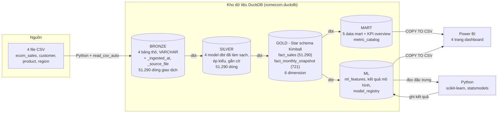
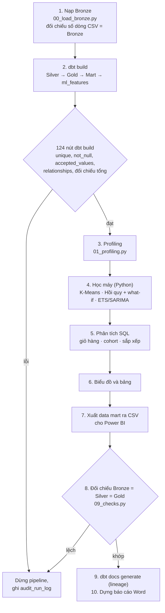
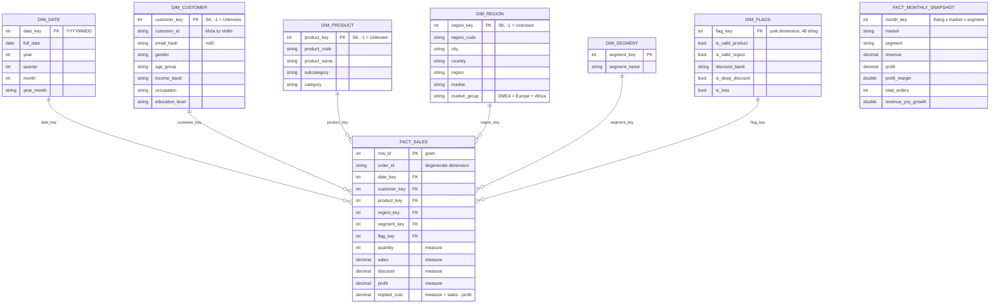
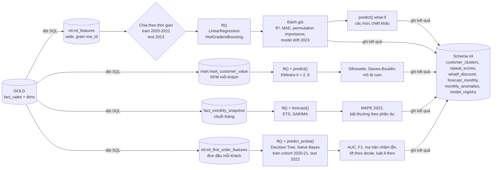

# CHƯƠNG 3. PHƯƠNG PHÁP LUẬN VÀ THIẾT KẾ HỆ THỐNG

Hệ thống được thiết kế theo hướng ELT: dữ liệu thô được nạp vào DuckDB trước, sau đó biến đổi bằng SQL qua dbt theo ba tầng Bronze, Silver và Gold. Học máy và dashboard là các lớp khai thác dữ liệu trên Gold; lõi của đề tài là kho dữ liệu.

## 3.1. Tiếp cận đề xuất và lý do chọn công nghệ

Nhóm chọn ELT thay vì ETL vì dữ liệu nhỏ (khoảng 100 nghìn dòng trên bốn bảng) và máy tính cá nhân đủ sức tính toán. Khi nạp nguyên bản vào kho trước, mọi phép biến đổi đều được viết bằng SQL, được quản lý phiên bản và kiểm thử ngay trong dbt, và có thể chạy lại bất cứ lúc nào từ tầng Bronze.

DuckDB được chọn làm kho dữ liệu vì năm lý do:

1. DuckDB là cơ sở dữ liệu cột (OLAP) chạy trong tiến trình, không cần máy chủ.
2. Toàn bộ kho nằm trong một file `.duckdb`, nên dễ nộp bài và dễ tái lập.
3. DuckDB đọc trực tiếp CSV và Parquet.
4. DuckDB miễn phí.
5. dbt có adapter `dbt-duckdb` cho DuckDB.

dbt Core cung cấp mô hình hóa theo thư mục, quản lý phụ thuộc giữa các model (`ref`, `source`), kiểm thử dữ liệu, macro Jinja để tái sử dụng công thức KPI, và tài liệu kèm sơ đồ lineage. Học máy chạy bằng Python (scikit-learn, statsmodels): Python đọc dữ liệu Gold từ DuckDB rồi ghi kết quả ngược vào kho. Dashboard dùng Power BI, đọc các data mart được xuất ra CSV.

## 3.2. Kiến trúc tổng thể

{H3.1} mô tả luồng dữ liệu, đọc từ trái sang phải. CSV được nạp vào Bronze, làm sạch ở Silver và mô hình hóa ở Gold. Từ Gold, dữ liệu đi tiếp sang hai nhánh khai thác: data mart cho dashboard, và bảng đặc trưng cho mô hình học máy. Số dòng ghi dưới mỗi tầng là kết quả thật sau khi chạy pipeline.

::mermaid H3.1 H3_1_kien_truc_tong_the | Kiến trúc tổng thể và các tầng Medallion của kho dữ liệu Xóm E-Com

## 3.3. Công nghệ sử dụng

::table B3.1 | Công nghệ sử dụng và vai trò | Nhóm thực hiện
| Thành phần | Công nghệ (phiên bản) | Vai trò |
|---|---|---|
| Nạp dữ liệu | DuckDB `read_csv_auto`, Python 3.11 | Đọc CSV và nạp vào Bronze |
| Kho dữ liệu | DuckDB 1.5 | Lưu trữ và tính toán cột (OLAP), một file |
| Biến đổi | dbt Core 1.12 + dbt-duckdb 1.11 | Model Silver, Gold, mart, ml; kiểm thử; tài liệu; lineage |
| Học máy | scikit-learn 1.8, statsmodels 0.14, joblib | Huấn luyện trên Gold, ghi kết quả về schema ml |
| Trực quan hóa | matplotlib (báo cáo), Power BI (dashboard) | Biểu đồ phân tích và dashboard kể chuyện |
| Điều phối | Python `run_all.py` | Chạy toàn bộ pipeline bằng một lệnh, dừng khi lỗi |
| Mã nguồn | Git | Quản lý phiên bản, tái lập |

## 3.4. Quy trình ELT và thứ tự chạy pipeline

{H3.2} trình bày thứ tự chạy, gộp cả quy trình kiểm thử chất lượng. Mọi bước được điều phối bởi `scripts/run_all.py`: một lệnh chạy từ nạp CSV đến dựng báo cáo, và dừng ngay khi có bước lỗi. Lệnh `dbt build` vừa chạy model vừa chạy kiểm thử theo thứ tự phụ thuộc, nên một model sẽ không được dùng tiếp nếu kiểm thử của nó thất bại.

::mermaid H3.2 H3_2_luong_elt | Luồng ELT, thứ tự chạy pipeline và các điểm kiểm thử chất lượng

## 3.5. Tầng Bronze: dữ liệu thô

Bốn file CSV được nạp nguyên bản vào schema `bronze` bằng hàm `read_csv_auto(..., all_varchar = true)`. Mọi cột được giữ dạng VARCHAR để Bronze phản ánh đúng nguồn, không mất thông tin do suy luận kiểu sai. Mỗi bảng có thêm hai cột metadata `_ingested_at` (thời điểm nạp) và `_source_file` (tên file nguồn) để truy vết. Script nạp tự so sánh số dòng CSV với số dòng Bronze và dừng nếu lệch. Trong dbt, bốn bảng Bronze được khai báo là `source` kèm kiểm thử `unique` và `not_null` trên khóa chính.

## 3.6. Tầng Silver: làm sạch và chuẩn hóa

dbt tạo bốn model trong schema `silver`: `silver_customer`, `silver_product`, `silver_region` và `silver_sales_integrated`. Silver ép kiểu (DATE, INTEGER, DECIMAL), chuẩn hóa giá trị (M/F thành Male/Female, Y/N thành boolean, subcategory về chữ thường) và tích hợp bảng giao dịch với ba danh mục. Model này cũng tính sẵn các cột dẫn xuất dùng chung: `order_year`, `implied_cost = sales - profit`, `is_loss`, nhóm chiết khấu (`discount_band`) và tuổi tại ngày tham chiếu. Nguyên tắc của tầng này là không xóa dữ liệu có ý nghĩa kinh doanh và ghi lại mọi ngoại lệ ({B3.2}).

::table B3.2 | Quy tắc làm sạch ở tầng Silver | Nhóm thực hiện
| Vấn đề | Quy tắc xử lý | Lý do |
|---|---|---|
| 11.041 dòng lợi nhuận âm | Giữ nguyên, thêm cờ `is_loss` | Giao dịch lỗ thật, là đối tượng của Q1 |
| 124 khách thiếu giới tính | Gán `Unknown`, cờ `is_gender_imputed`, giữ bản ghi | Không làm mất 362 dòng giao dịch |
| 2 mã sản phẩm và 1 mã khu vực không khớp (3 dòng giao dịch, trong đó 1 dòng lỗi cả hai mã) | Giữ mã gốc, cờ `is_valid_product` / `is_valid_region`, không xóa | Bảo toàn doanh thu; Gold trỏ tới thành viên Unknown |
| order_id lặp ở nhiều dòng | Hợp lệ (nhiều dòng mỗi đơn), không khử trùng | Grain là dòng sản phẩm, không phải đơn |
| Năm trong order_id lệch 8 năm | Bỏ qua; dùng `order_date` | Một trục thời gian duy nhất |
| Tuổi thay đổi theo ngày chạy | Cố định ngày tham chiếu 31/12/2023 (biến dbt `reference_date`) | Kết quả tái lập được |
| Chiết khấu có 23 mức rời rạc | Gom thành 6 nhóm (macro `discount_band`) | Thống nhất giữa Silver, Gold và mart |

Kiểm thử dbt ở Silver gồm `unique` và `not_null` trên khóa; `accepted_values` cho giới tính, phân khúc, ngành hàng và thị trường; `relationships` từ giao dịch tới khách hàng.

## 3.7. Tầng Gold: mô hình hóa Kimball

### 3.7.1. Bốn bước thiết kế

Tầng Gold được thiết kế theo bốn bước của Kimball:

1. **Chọn quy trình nghiệp vụ:** bán hàng trực tuyến.
2. **Khai báo grain:** một dòng sản phẩm trong một đơn hàng (`row_id`).
3. **Xác định dimension:** ngày, khách hàng, sản phẩm, khu vực, phân khúc, cờ chất lượng.
4. **Xác định fact:** số lượng, doanh thu, chiết khấu, lợi nhuận, chi phí ngầm.

Grain mức dòng là mức chi tiết nhất có trong nguồn. Nhờ đó mọi phân tích (theo đơn, khách, tháng) đều tổng hợp được từ fact mà không mất thông tin.

### 3.7.2. Star schema

::mermaid H3.3 H3_3_star_schema | Star schema Kimball của tầng Gold: fact_sales ở trung tâm, sáu dimension và fact_monthly_snapshot

::table B3.3 | Các bảng của tầng Gold | Nhóm thực hiện, số dòng lấy từ kho sau khi chạy
| Bảng | Loại | Số dòng | Nội dung chính |
|---|---|---|---|
| fact_sales | Transaction fact | 51.290 | Grain row_id; order_id là degenerate dimension; sắp xếp vật lý theo order_date |
| fact_monthly_snapshot | Periodic snapshot fact | 721 | Lưới đầy đủ 48 tháng × 5 market × 3 segment (ô trống = 0) + 1 ô Unknown; doanh thu, lợi nhuận, biên, tăng trưởng cùng kỳ |
| dim_date | Dimension | 1.461 | Phân cấp ngày, tuần, tháng, quý, năm |
| dim_customer | Dimension (SCD Type 1) | 17.416 | Nhóm tuổi, nhóm thu nhập, nghề nghiệp, học vấn; email băm; bỏ họ tên và ngày sinh |
| dim_product | Dimension | 28.357 | Sản phẩm → subcategory → category |
| dim_region | Dimension | 3.829 | Thành phố → quốc gia → region → market → market_group |
| dim_segment | Dimension | 4 | Consumer, Corporate, Self-Employed, Unknown |
| dim_flags | Junk dimension | 48 | Tổ hợp cờ hợp lệ, nhóm chiết khấu, cờ lỗ |

### 3.7.3. Các kỹ thuật Kimball được áp dụng

- **Surrogate key và thành viên Unknown:** mọi dimension dùng khóa thay thế số nguyên (sinh bằng `row_number()` theo khóa tự nhiên) và có một dòng Unknown với khóa −1. Giao dịch có mã không khớp trỏ vào −1 thay vì bị mất khi nối bảng, nên kho không bao giờ có khóa ngoại NULL.
- **Degenerate dimension:** `order_id` không có thuộc tính riêng nên được giữ trong fact, dùng để đếm đơn và phân tích giỏ hàng.
- **Junk dimension:** bốn cờ ít giá trị (hợp lệ sản phẩm, hợp lệ khu vực, nhóm chiết khấu, lỗ) được gom thành `dim_flags` gồm 48 tổ hợp, tránh để nhiều cột cờ rời rạc trong fact.
- **Periodic snapshot fact:** `fact_monthly_snapshot` chụp trạng thái mỗi tháng theo thị trường và phân khúc trên một lưới đầy đủ. Nhờ vậy hàm `lag(…, 12)` luôn so đúng cùng kỳ năm trước, kể cả với ô không có giao dịch. Bảng phục vụ theo dõi tăng trưởng, bão hòa và chuỗi thời gian.
- **Sắp xếp theo ngày:** `fact_sales` được ghi theo thứ tự `order_date`, giúp DuckDB bỏ qua các khối dữ liệu (row group) ngoài khoảng thời gian cần lọc nhờ thống kê min/max (zonemap). Tác động được đo ở mục 4.3.
- **Phân cấp trong dimension:** ngày → tháng → quý → năm; sản phẩm → subcategory → category; thành phố → quốc gia → region → market → market_group. Các phân cấp này hỗ trợ thao tác roll-up và drill-down trên dashboard.

Nhóm không dùng accumulating snapshot fact vì dữ liệu không có vòng đời đơn hàng (không có ngày giao hay ngày thanh toán). Nhóm cũng không dùng SCD Type 2 vì thuộc tính khách hàng không có lịch sử thay đổi; `dim_customer` là SCD Type 1.

## 3.8. KPI và metric catalog

Mỗi KPI được định nghĩa đúng một lần bằng macro dbt (`macros/metrics.sql`) và được mô tả trong bảng `main.metric_catalog` (nạp từ seed CSV). Mọi data mart gọi macro thay vì tự viết lại công thức, nên các báo cáo luôn dùng cùng một định nghĩa.

::csvtable B3.4 | Metric catalog: 9 KPI và công thức | Bảng main.metric_catalog trong kho | ../../dbt/seeds/metric_catalog.csv | kpi_name:KPI:str;formula:Công thức:str;unit:Đơn vị:str;dbt_macro:Macro dbt:str;business_question:Câu hỏi:str

## 3.9. Data mart

Năm data mart (schema `mart`) phục vụ năm câu hỏi nghiên cứu. Tất cả được xây trên cùng một bảng trung gian `int_sales_wide` (dạng ephemeral, không lưu) là fact nối đủ sáu dimension. Mỗi data mart được kiểm thử tính duy nhất theo grain và được xuất ra CSV bằng lệnh `COPY ... TO` để Power BI đọc.

::table B3.5 | Năm data mart: mục đích, grain và câu hỏi phục vụ | Nhóm thực hiện
| Data mart | Grain | Nội dung | Câu hỏi |
|---|---|---|---|
| mart_segment_profitability | Năm × phân khúc × thị trường | P&L: doanh thu, chi phí ngầm, lợi nhuận, biên, số đơn, AOV, tỷ lệ dòng lỗ, số tiền lỗ | Q2, Q5 |
| mart_product_profitability | Năm × sản phẩm | Doanh thu, lợi nhuận, biên, số lượng, đơn giá, chiết khấu bình quân theo sản phẩm, subcategory, category | Q1, Q5 |
| mart_geographic_performance | Năm × quốc gia × region | Doanh thu, biên, tỷ lệ giảm giá sâu, tăng trưởng so với năm trước, tọa độ | Q3 |
| mart_discount_analysis | Năm × mức chiết khấu × ngành hàng × thị trường × phân khúc | Số dòng, doanh thu, lợi nhuận, biên, số dòng lỗ | Q1, Q5 |
| mart_customer_value (+ mart_customer_cohort) | Khách hàng (cohort: năm đầu × năm hoạt động) | RFM tại 31/12/2023, số đơn, giá trị, lợi nhuận, nhóm RFM, cohort, tỷ lệ quay lại | Q4 |

Bổ sung `mart_kpi_overview` tổng hợp đủ 9 KPI theo năm và toàn kỳ (dùng `GROUP BY ROLLUP`).

## 3.10. Học máy trên kho dữ liệu

### 3.10.1. Quy trình

Hai bảng đặc trưng được tính bằng SQL trong dbt trên dữ liệu Gold, đóng vai trò một feature store đơn giản: `ml.ml_features` dạng wide (grain `row_id`) cho hồi quy, và `ml.ml_first_order_features` (grain khách hàng, chỉ thông tin của đơn đầu) cho phân lớp. Python đọc bảng này từ DuckDB để huấn luyện mô hình (fit), đánh giá, dự đoán (predict), rồi ghi bảng kết quả vào schema `ml`. Thông tin mô hình (phiên bản, tham số, chỉ số) được lưu vào `ml.model_registry`, còn file mô hình được lưu bằng joblib ({H3.4}).

Có hai nguyên tắc chống rò rỉ dữ liệu:

1. Dữ liệu được chia theo thời gian: huấn luyện trên 2020–2022, kiểm tra trên 2023. Không chia ngẫu nhiên, vì chia ngẫu nhiên sẽ để mô hình "nhìn thấy" năm 2023 khi học.
2. Mô hình chỉ dùng đặc trưng biết trước khi bán. `sales`, `profit` và `implied_cost` không được dùng làm đặc trưng; chúng chỉ là nhãn hoặc dùng để đánh giá.

::mermaid H3.4 H3_4_quy_trinh_ml | Quy trình học máy trên dữ liệu Gold

### 3.10.2. Các mô hình

::table B3.6 | Các mô hình khai phá dữ liệu và học máy: thuật toán, mục đích và cách đánh giá | Nhóm thực hiện
| Mô hình | Công cụ | Mục đích | Đánh giá |
|---|---|---|---|
| Phân cụm khách hàng RFM + lợi nhuận | KMeans (scikit-learn); log có dấu + StandardScaler | Nhóm khách theo giá trị và hành vi (Q4) | Silhouette, Davies-Bouldin; mô tả cụm bằng thu nhập, nghề nghiệp, phân khúc |
| Hồi quy biên lợi nhuận | LinearRegression (one-hot), HistGradientBoostingRegressor (ràng buộc đơn điệu theo chiết khấu) | Xác định yếu tố quyết định biên (Q1, Q5) | R², MAE trên train và test 2023; permutation importance; model drift |
| What-if chiết khấu | predict() ở các mức 0–60% và kịch bản trần | Tìm ngưỡng hòa vốn, ước lượng lợi nhuận khi giới hạn chiết khấu (Q1) | Lợi nhuận dự báo theo kịch bản |
| Phân lớp khách quay lại trong 365 ngày | DecisionTreeClassifier (entropy, giống C4.5, sâu 4), CategoricalNB (Naive Bayes trên đặc trưng rời rạc hóa) | Chấm điểm khách mới để ưu tiên giữ chân; tìm yếu tố của đơn đầu gắn với việc quay lại (Q4) | AUC, F1, precision, recall, ma trận nhầm lẫn trên cohort 2022; lift theo decile; luật if-then |
| Luật kết hợp | Apriori tự cài theo các bước của bài giảng (L1 → C2 → tỉa → L2 → L3); item = subcategory, giao dịch = đơn hàng | Tìm nhóm ngành hàng mua cùng nhau để bán chéo (Q4) | Support, confidence, lift; số luật đạt minsup, minconf |
| Chuỗi thời gian và bất thường | ETS Holt-Winters, SARIMA(1,1,1)(0,1,1)12 (statsmodels) | Dự báo doanh thu, lợi nhuận theo tháng; định vị điểm gãy 2023 (Q5) | MAPE 2023; khoảng dự báo 95%; phần dư chuẩn hóa vượt ±2 độ lệch chuẩn |

::table B3.7 | Danh sách đặc trưng của ml_features | Nhóm thực hiện
| Đặc trưng | Cách tính | Dùng cho | Ghi chú |
|---|---|---|---|
| discount | Tỷ lệ chiết khấu dòng | Hồi quy, what-if | Biến điều khiển của what-if |
| quantity | Số lượng dòng | Hồi quy | Biết khi đặt hàng |
| prior_orders | Số đơn khách đã mua trước đơn hiện tại (`dense_rank` theo ngày) | Hồi quy | Chỉ nhìn quá khứ |
| lines_in_order | Số dòng trong đơn | Hồi quy | Biết khi đặt hàng |
| month, year | Tháng, năm đặt hàng | Hồi quy (year chỉ ở mô hình triển khai) | Bắt mùa vụ, mức biên theo năm |
| category, subcategory | Từ dim_product | Hồi quy | Phân loại |
| market, segment | Từ dim_region, dim_segment | Hồi quy | Phân loại |
| annual_income, gender, age_group, occupation, education_level, marital_status, is_home_owner | Từ dim_customer | Hồi quy | Thuộc tính khách |
| recency_days, frequency, monetary, profit | Từ mart_customer_value tại 31/12/2023 | K-Means | Cấp khách hàng |
| first_sales, first_quantity, first_lines, first_discount, first_n_categories, first_main_category | Thông tin đơn đầu của khách (ml_first_order_features) | Phân lớp | Biết ngay sau đơn đầu |
| returned_365d | Có đơn thứ hai trong 365 ngày | Nhãn phân lớp | Chỉ khách có đơn đầu đến hết 2022 để đủ 365 ngày quan sát |
| sales, profit, implied_cost | Nhãn | Không dùng làm đặc trưng | Loại để tránh rò rỉ (target = profit / sales) |

## 3.11. Quản trị dữ liệu

- **Lineage và tài liệu:** mọi model, cột và kiểm thử có mô tả trong `schema.yml`. Lệnh `dbt docs generate` sinh trang tài liệu kèm sơ đồ lineage từ source Bronze đến mart và ml ({H3.5}).
- **Bảo vệ dữ liệu cá nhân:** DuckDB không có phân quyền theo cột, nên dữ liệu cá nhân được bảo vệ bằng thiết kế ({B3.8}). Dữ liệu thô và file kho không đưa lên Git (`.gitignore`).
- **Giám sát chất lượng:** hook `on-run-end` của dbt (macro `log_run_results`) ghi kết quả từng model và từng kiểm thử sau mỗi lần chạy vào bảng `main.audit_run_log`. Script `09_checks.py` đối chiếu số dòng và tổng tiền giữa các tầng, và dừng pipeline nếu lệch.
- **Quản lý mô hình:** mô hình được đặt tên có phiên bản (ví dụ `kmeans_rfm_v1`, `margin_hgb_v1`) và lưu bằng joblib; tham số và chỉ số đánh giá được ghi vào `ml.model_registry`.
- **Tự động hóa và tái lập:** `run_all.py` chạy toàn bộ pipeline. Các tham số nghiệp vụ (ngày tham chiếu, ngưỡng giảm giá sâu 30%) được khai báo một lần dưới dạng biến dbt. Mọi mô hình học máy dùng `random_state` cố định.

::screenshot H3.5 | Data lineage từ Bronze đến Gold, data mart và ml (dbt docs) | Chạy: python scripts/run_dbt.py docs serve, mở Lineage Graph, chụp toàn bộ sơ đồ

::table B3.8 | Biện pháp bảo vệ dữ liệu cá nhân | Nhóm thực hiện
| Cột | Biện pháp | Lý do |
|---|---|---|
| first_name, last_name | Chỉ có ở Bronze và Silver; không đưa lên Gold, mart, CSV | Định danh trực tiếp |
| email_address | Băm md5 ở dim_customer; không xuất ra CSV | Định danh trực tiếp, vẫn cần để kiểm tra trùng |
| birth_date | Đổi thành tuổi và nhóm tuổi (23–29, 30–39, …, 60+) tại 31/12/2023 | Ngày sinh kết hợp với thông tin khác có thể định danh |
| customer_id | Thay bằng customer_key (surrogate) trong CSV cho Power BI | Không lộ mã khách gốc ra ngoài kho |
| annual_income | Giữ giá trị ở Gold; trong CSV chỉ dùng income_band | Thông tin nhạy cảm tài chính |
